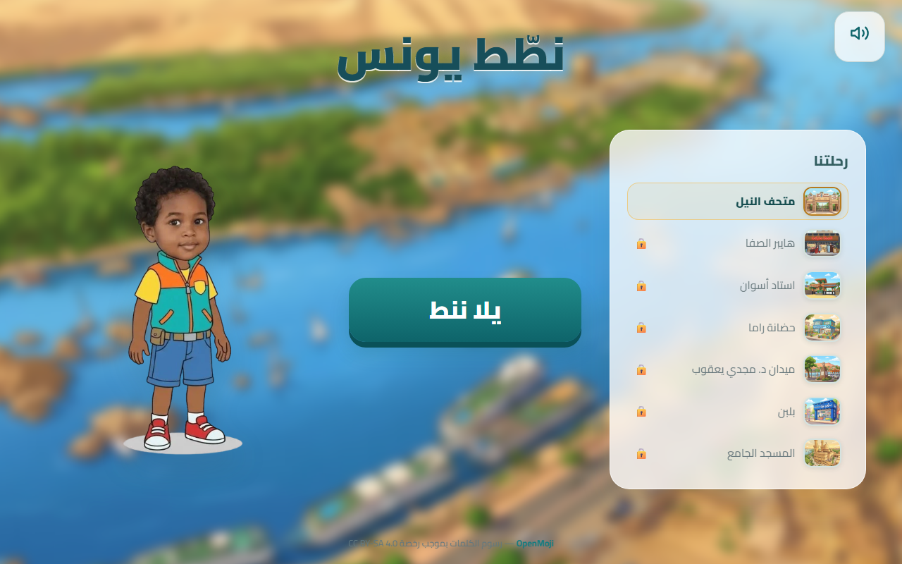
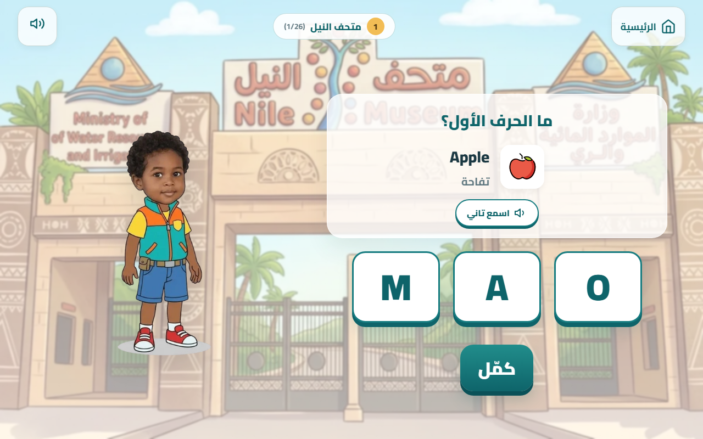
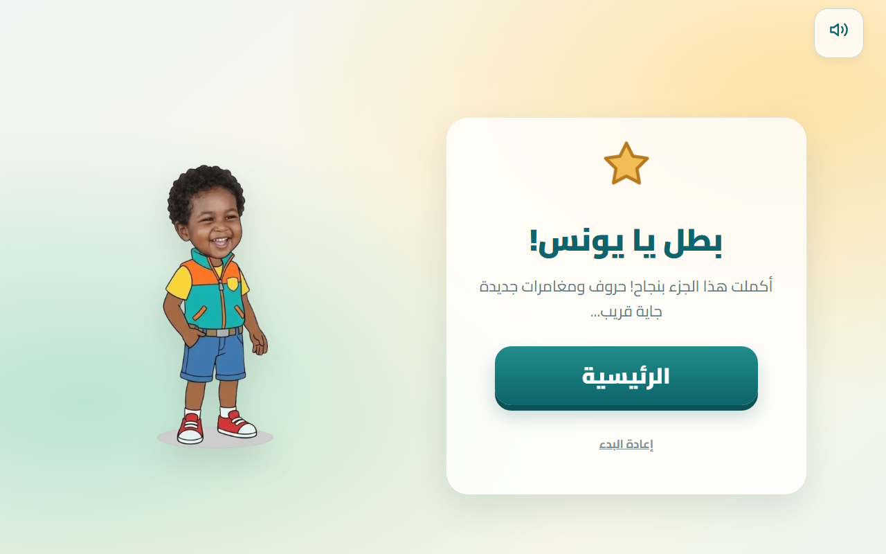
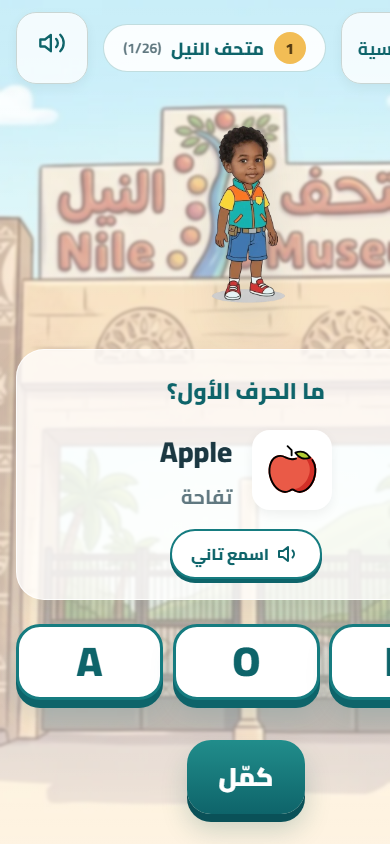

<div dir="rtl" align="center">

# 🎈 نطّط يونس

**لعبة ويب تعليمية لأطفال من سن ٤ سنوات — يونس بيتعلم حروف الإنجليزية وهو بينطّط بين محطات أسوان المفضّلة له!**

[▶️ العب الآن أونلاين](https://majekahmed.github.io/natat-younes/)



</div>

<div dir="rtl">

## 😅 الحكاية من الأول

في ظل زن ونوس علينا هو عاوز يشتغل زي بابا.

مش أي شغللاً… عاوز يقعد على الكمبيوتر، يفتح حاجة، ويكتب زي ما بابا بيكتب، وهو لسه ما كمّلش الـ ٥ سنين! كل ما بابا يقعد شغل، يونس بيظهر جنبه بطلب واحد مش هيدّي عليه:

> «أنا كمان عاوز أشتغل عليه!»

وبعد مفاوضات مطوّلة فشلت كلها 😅، قرر بابا يحل المشكلة بالطريقة الوحيدة اللي هتقبّلها: يبني له **شغل حقيقي** يا لعبها يا ينام:

> **يونس → أصغر "زميل عمل" في الشركة، ومشروعه الأول: نطّط يونس 🚀**

وهكذا اتولدت **نطّط يونس**: لعبة أونلاين يقدر يلعبها من الموبايل أو الكمبيوتر، يونس هو بطلها، والقاعده الأساسية واحدة: **إجابة صح = نطّة وفرحة** 🎉

## 🎮 اللعبة إزاي؟ (سهلة جداً — الطفل يلعب لوحده)

| الخطوة | اللي بيحصل |
|:---:|:---|
| ١ | تظهر للحرف والكلمة بصورتها، واللعبة تنطقهم بصوت واضح 🔊 |
| ٢ | ياخد يونس يختار الحرف الصحيح من **٣ كروت كبيرة مكتوب عليهم الحروف** |
| ٣ | صح؟ مبروك! 🎉 مفيش شاشة مملة — بيكمل للحرف اللي بعده على طول |
| ٤ | غلط؟ مفيش "Game Over" ولا عدّاد أخطاء ولا حاجة مفزوعة — اللعبة بتزقّه بلطف ناحية الإجابة الصح، وهو بيكمل وهو مبسوط 😎 |

<div align="center">

| شاشة المهمة (اختار الحرف الصح) | شاشة الإنجاز 🎉 |
|:---:|:---:|
|  |  |

**وعلى الموبايل كمان 📱:**



</div>

### ✨ مميزات اللعبة

- **مش محتاج يعرف يقرأ** 👀 — الطفل يسمع النطق ويلتقط الحرف بعينه، مش لازم يفهم ولا حاجة مكتوبة.
- **٢٦ حرفاً (A–Z)** بكل واحدة كلمة بسيطة وصورة واضحة (Apple 🍎 → Zebra 🦓).
- **نطق صوتي لكل حرف وكل كلمة** — يساعد الطفل يربط الشكل بالصوت.
- **مؤشر ماوس على شكل نجمة ⭐ بحجم كبير** — مصمم خصيصاً لأن اللي بيتحكم في الماوس لسه صغير ودخوله ومقاسه مش دقيقين.
- **دعم كامل للكيبورد** — لو الطفل داس على الحرف الصح من الكيبورد، اللعبة بتنقله للخطوة اللي بعدها مباشرة.
- **٧ محطات ملونة من أسوان** بخلفيات وصور حقيقية جنب كل محطة، ومفيش محطة تفتح غير لما اللي قبلها يخلص — عشان الطفل يحس بإنجاز حقيقي 🏅.
- **لا إعلانات، لا تسجيل، لا جمع بيانات، لا إنترنت مطلوب بعد أول مرة** — كل حاجة شغالة داخل المتصفح بأمان.
- **متوافقة مع الموبايل والتابلت والكمبيوتر** — واجهة واحدة مرنة تظبط نفسها على أي شاشة.

## 🗺️ محطات أسوان (الأماكن اللي يونس بيحبها)

اللعبة مش مجرد كروت — دي جولة حقيقية في أسوان. يونس بيتنقل بين ٧ محطات، وكل محطة فيها مجموعة حروف، وصورتها ظاهرة جنبها في خريطة اللعبة:

| # | المحطة | ليه يونس بيحبها؟ |
|:-:|:---|:---|
| ١ | **متحف النيل** | الآثار والنيل ومساحة يجرى فيها على راحته |
| ٢ | **هايبر الصفا** | الأجواء اللي بيتمشى مع بابا بين الأرفف |
| ٣ | **استاد أسوان** | الكرة والتشجيع والصياح المسموح |
| ٤ | **حضانة راما** | أصحابه والألعاب والروتين المحبب |
| ٥ | **ميدان د. مجدي يعقوب** | الساحة الكبيرة والجري والصراخ |
| ٦ | **بلبن** | نزهة أسبوعية كلاسيكية ومساحات خضرا |
| ٧ | **المسجد الجامع** | атмосферة خاصة وسلم بيطلعه بسرعة |

## 🛠️ للمبرمجين اللي عاوزين يطوروها

المشروع **مفتوح المصدر** على GitHub ومرحّب بأي حد يتعلّم منه أو يطوّره:

- **تقنيات بسيطة:** Vite + JavaScript خالص (من غير React ولا Vue ولا تعقيد) — ممتازة كنقطة بداية للمبتدئين.
- **إضافة حرف جديد** = مدخلة في `src/data/letters.js` فقط، بدون لمس أي كود.
- **إضافة محطة جديدة** = مدخلة في `src/data/stations.js` + صورة الخلفية، وخلاص.

```text
npm install        # حمّل الحزم
npm run dev        # شغّل السيرفر المحلي
npm run build      # ابنِ نسخة الإنتاج
npm run preview    # جرّب نسخة الإنتاج محلياً
npm run validate   # تحقق من سلامة البيانات
```

<div dir="ltr">

```text
src/
├── css/        → styles (start / mission / base)
├── data/       → letters.js, stations.js, characters.js, strings.ar.js
└── js/         → game engine, audio, progress, assets loader
public/
├── assets/     → images, audio, fonts (Cairo)
└── characters/younes/ → Younes visuals (protected ⚠️)
docs/           → guides & screenshots
scripts/        → data validation
```

</div>

**النشر:** أي `push` على `main` بيشغّل GitHub Actions ويبني وينشر على GitHub Pages تلقائياً.

## 🔐 الترخيص والحقوق

### ✅ المسموح

- الكود + التوثيق: رخصة **[MIT](LICENSE)** — استخدم، عدّل، انشر، وعلّم أطفالكم.
- لعبة نطّط يونس متاحة مجاناً لأي طفل في أي مكان 🌍، ومناسبة لعمر ٤ سنوات وما فوق.
- رسوم الكلمات (٢٦ صورة SVG): من [OpenMoji](https://openmoji.org) — ⓒ OpenMoji برخصة **CC BY-SA 4.0**.
- الخط: [Cairo](https://github.com/google/fonts/tree/main/ofl/cairo) برخصة **SIL Open Font License**.

### ❌ الممنوع (بجد)

> ⚠️ **شخصية يونس** — صوره، فيديوهاته، وملامحه — **غير مشمولة في الرخص المفتوحة**.
> جميع حقوق الشخصية محفوظة لمالكها، ولا يجوز استخدام الشخصية أو أصولها في أي مشروع أو منتج أو إعلان **إلا بالرجوع لمالكها والحصول على إذن صريح منه**.
> الأولاد لهم حقوق، واللي بيخالف ده بيحاسب منه يونس نفسه 😤 (وهو لسه بيلخبط بين M و N 😅).

للتفاصيل: [شروط الاستخدام TERMS.md](TERMS.md) و[رخصة MIT LICENSE](LICENSE).

## 🔮 اللي جاي (خطة نوس المستقبلية)

اللعبة اتجرّبت على المستخدم الأول (يونس، ٤ سنوات) والنتيجة الأولية: **المستخدم متحمس ومتفاعل ويطلب المزيد** 📈

فالخطة الحالية إنه:

- 🔢 **إضافة الأرقام** — لو يونس فضل متحمس وشايف الحروف، هنفكر جدي إننا نضيف الأرقام بمحطات **جديدة** جوا أسوان أو خارجها — لسه مفيش قرار نهائي.
- 🎧 استبدال الصوتيات المؤقتة بتسجيلات بشرية بجودة أعلى لنطق الحروف والكلمات.
- 🌍 وربما لغات إضافية… لكن ده كله **حسب تفاعلكم مع اللعبة، وتفاعل يونس كمان معاها**.

القرار النهائي بيتم على قهوة الفجر (وده بيحصل بس يوم يونس ينام بدري 😴).

---

<div align="center">

صُنعت بحب… من "بابا" لصغيره يونس ❤️

[▶️ ابدأ الرحلة الآن →](https://majekahmed.github.io/natat-younes/)

</div>
</div>
